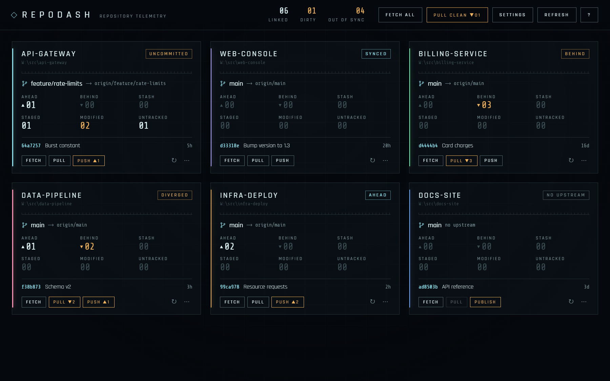
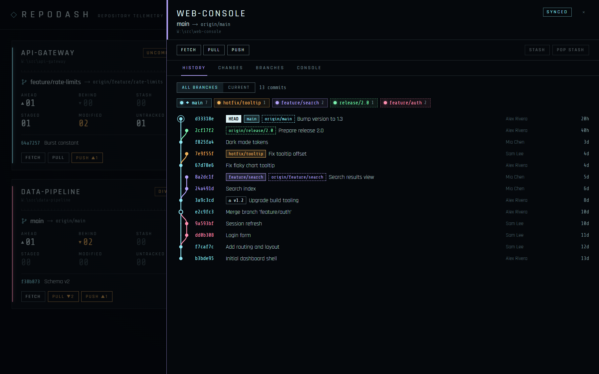
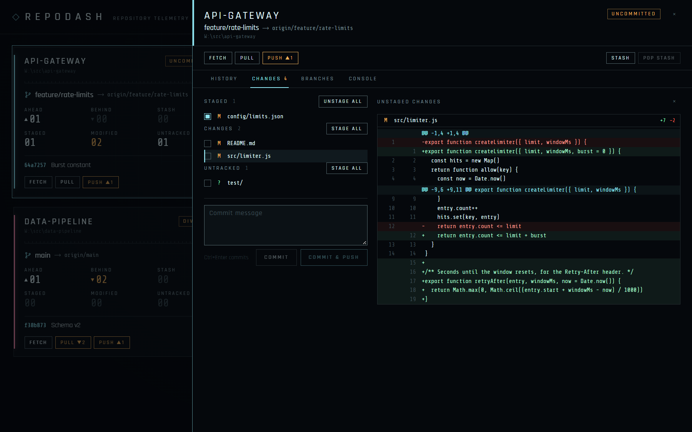

# RepoDash

A desktop dashboard for the git repositories you have cloned locally. Every repository is a card showing its
branch, what is ahead, behind, staged, modified or untracked, and the last commit. From a card or its panel you
fetch, pull, push, switch and create branches, stage and commit, stash, and read history and diffs. The look is
inspired by the HUD screens of the film *Oblivion*.

Windows, macOS and Linux (Electron). RepoDash runs your own `git`, so credential helpers, SSH keys, hooks and
`.gitconfig` behave exactly as they do in your terminal.



## Features

- **Cards** for each repository: one-word state (synced, behind, diverged, uncommitted, conflict…), counts,
  last commit. Drag cards to reorder them, give each one a colour and an alias.
- **Live status** — a file watcher refreshes a card when something changes, also when you work in a terminal or
  an editor. Nothing runs while nothing changes.
- **Sources** — add a folder to scan for repositories (depth-limited, nested clones included) or single
  repositories. Remove a scanned repository from the dashboard and it stays hidden until you restore it.
- **Operations** — fetch, pull, push (publish a new branch to `origin`), switch to a local or remote branch,
  create a branch, stage / unstage, commit (and push), stash / pop, continue or abort a merge or rebase.
  Git's output streams into a console per repository; a failure tells you git's reason, not just "failed".
- **History** with a commit graph: every branch has its own colour, and the legend picks one out.
- **Diffs** of unstaged, staged, conflicted and new files, and of any commit in the history.
- **Fetch all** and **Pull clean** — update every repository that has no local changes and is only behind.
- **Background** — optional auto fetch every 5–60 minutes, desktop notifications for new remote commits and
  finished operations while RepoDash is in the background, a tray icon and a taskbar / dock badge while any
  repository has uncommitted changes.
- **Keyboard** for everything (press `?` in the app).

| History with the branch graph | Changes with a diff |
| --- | --- |
|  |  |

## Safe by default

- Pull is fast-forward only. A branch that has diverged asks whether to **rebase** or **merge** (uncommitted
  changes are stashed and put back around it). After a conflict you mark files resolved and **continue**, or
  **abort**.
- Switching branches with uncommitted changes asks: carry the changes over, or stash them first.
- Aborting a merge or rebase asks first. There is no force push.
- git never waits for a password prompt; it fails and says why.

## Install

There are no prebuilt releases yet; build RepoDash from source. You need [git](https://git-scm.com/) on your
`PATH` and [Node.js](https://nodejs.org/) 22.12 or newer.

```sh
git clone https://github.com/daveage/RepoDash.git
cd RepoDash
npm ci
npm run dist
```

`npm run dist` builds an installer for the platform you run it on into `dist/`: an NSIS installer on Windows,
a `.dmg` on macOS, an AppImage on Linux. The builds are not code-signed, so Windows SmartScreen and macOS
Gatekeeper ask before the first start.

To run RepoDash without installing it:

```sh
npm run dev
```

## Using it

1. **Settings → Scan folders → + Add** a folder that holds your clones, e.g. `~/src`; or **+ Add** single
   repositories. On an empty dashboard the same buttons are in the middle of the screen.
2. Click a card's branch, counts or last commit to open its panel on Branches, Changes or History.
3. **Settings → Background** turns on auto fetch and notifications.

Directories passed on the command line are added as repositories: `RepoDash ~/src/api ~/src/web`
(or `npm run dev -- ~/src/api` while developing).

### Keyboard

| Keys | Action |
| --- | --- |
| Arrows, Home, End | Move between cards |
| Enter / C / B / L | Open History / Changes / Branches / Console |
| F, P, Shift+P | Fetch, pull, push |
| Shift+F, Shift+U | Fetch all, pull clean |
| R, Shift+R | Refresh the card, refresh all |
| Space on a card header | Pick the card up; arrows move it, Space drops it |
| 1 – 4 | Panel tabs |
| J / K | Older / newer commit in a commit diff |
| Ctrl+Enter | Commit, in the message field |
| Esc | Leave a text field, close a diff, the panel or a dialog |
| ? | All shortcuts |

### Where settings are kept

`repodash.json` in the app's user data directory: `%APPDATA%\RepoDash` on Windows,
`~/Library/Application Support/RepoDash` on macOS, `~/.config/RepoDash` on Linux.

## Platform notes

- **Linux:** the working tree is not watched recursively (that costs one inotify watch per folder); edits there
  show up when the window gets focus. Changes to branches and the index are seen right away.
- **Windows:** notifications appear for the installed app; a `npm run dev` session may not show them.
- **Tray:** closing the window keeps RepoDash running in the tray (auto fetch, notifications and the badge go
  on); click the icon to bring it back, quit from its menu. Starting RepoDash again, e.g. from a pinned taskbar
  icon, shows the running one. On Linux desktops without a tray, start it again to get the window back.

## Development

```sh
npm run dev         # app with hot reload
npm run typecheck   # TypeScript check
npm run build       # production build into out/
npm run dist        # installer into dist/
npm run icons       # app icon from resources/icon-source.png, tray icons from resources/*.svg
```

Electron, React and TypeScript, built with electron-vite. The main process (`src/main`) runs git, watches
repositories and owns the settings. The renderer (`src/renderer`) has no Node access and talks to it through
a small preload API (`src/preload`). [repodash.md](repodash.md) describes the design: how status is read, how
branches get their history colours, how operations and diffs are run, and what each development phase added.

## Credits

The visual style is a tribute to the user interfaces GMUNK and team designed for the film *Oblivion*
([gmunk.com/Oblivion-GFX](https://gmunk.com/Oblivion-GFX)). RepoDash is not affiliated with them or with the
film. Fonts: [Rajdhani](https://fonts.google.com/specimen/Rajdhani) and
[Share Tech Mono](https://fonts.google.com/specimen/Share+Tech+Mono) (SIL Open Font License).

## License

[MIT](LICENSE)
